 

---

## 🧬 About me

I'm a final-year **B.Tech student at NIT Rourkela** who sits where **AI engineering meets product thinking**.
I build LLM-powered tools (agents, RAG pipelines, forecasting apps) and I care just as much about
*why* a product should exist as *how* it works.

- 🤖 **Right now:** building agentic assistants with **LangGraph + Gemini**, with human-in-the-loop approvals
- 🧪 **Previously:** ML Intern @ **Courtlay** · Product & Data Analytics Intern @ **Drushtant Infoweb**
- 📈 **Comfortable with:** EDA → feature engineering → models → dashboards → exec-ready recommendations
- 🎤 **Off-screen:** mentoring public speaking at **Hourglass** and running case workshops at the **Analytics & Consulting Club**
- 💬 **Ask me about:** RAG, time-series forecasting, GTM strategy, funnel analysis

  

---

## 🚀 Featured projects

Click any card to open the repo.

<table>
<tr>
<td width="50%" valign="top">

<a href="https://github.com/risitasutar/OmniiFlow-AI">💻 Code</a> · <a href="https://omniflow-ai-dmtyueqfrbwxxsmdrkhcjz.streamlit.app/">🌐 Live demo</a>

</td>
<td width="50%" valign="top">

<a href="https://github.com/risitasutar/AI-Video-Assistant">💻 Code</a> · <a href="https://ai-video-assistant-iypxnilbyydt3qxhxjrav4.streamlit.app/">🌐 Live demo</a>

</td>
</tr>
<tr>
<td width="50%" valign="top">

<a href="https://github.com/risitasutar/Gurgaon-Property-Assistant-App">💻 Code</a> · <a href="https://gurgaon-property-assistant-axthlfohuoywrnckdipln4.streamlit.app/">🌐 Live demo</a>

</td>
<td width="50%" valign="top">

<a href="https://github.com/risitasutar/ElectricPe-Casestudy">📂 Case study</a>

</td>
</tr>
<tr>
<td width="50%" valign="top">

<a href="https://github.com/risitasutar/plum-behavioural-case-study">📂 Case study</a>

</td>
<td width="50%" valign="top">

<a href="https://github.com/risitasutar/Blinkit-Sql-Project">💻 Code</a>

</td>
</tr>
</table>

<b>🔎 Click to see what's inside each project</b>

 

**🤖 OmniFlow AI**: an agentic assistant on LangGraph + Gemini that orchestrates **29 tools** across **8 Streamlit workspaces**
(PDF RAG with page citations, data analysis, forecasting, text-to-SQL, long-term memory). Every action needs human approval first,
and it has prompt-injection protection built in.

**🎬 AI Video Assistant**: summarises YouTube or local videos with Mistral AI and pulls out action items, decisions and open questions.
It runs end-to-end RAG on LangChain + ChromaDB with dual speech-to-text (Whisper for English, Sarvam AI for Hinglish).

**🏠 Gurgaon Real Estate Platform**: a Random Forest price model (**R² 0.90** on 10K+ listings), a weighted ensemble recommender
built on 3 cosine-similarity matrices, and 7 interactive Plotly/Seaborn analytics modules.

**⚡ ElectricPe Case Study**: funnel and KPI analysis that found an 81% lead-to-pre-booking rate and a 27% cancellation rate,
plus an exec deck projecting **+14% conversions**, **-1.2 days TAT** and **-12% cancellations**.

**🩺 Plum Behavioural Study**: secondary research, user interviews and journey mapping on teleconsultation no-shows, with 10+ MVP
interventions prioritised by impact vs. effort and A/B success metrics targeting 5–10% fewer no-shows.

**🛒 Blinkit SQL Analysis**: cleaning and EDA on 8K+ sales records, with CTEs, subqueries and window functions to rank products
and outlets by size and location tier.

<b>📦 More things I've built</b>

 

| Project | What it is |
|---|---|
| [Nova Multimodal Agent](https://github.com/risitasutar/nova-multimodal-agent) | LangGraph multimodal agent with tool routing, document + video RAG, memory and a FastAPI backend |
| [Epigamia GTM Case Study](https://github.com/risitasutar/Epigamia-GTM-Case-Study) | ML-backed portfolio analysis → GTM plan for a high-protein product *(Top 5 / 300+ at MESA)* |
| [Stock Analysis & Forecasting](https://github.com/risitasutar/Stock-Analysis-and-forcasting) | Time-series exploration and forecasting of stock prices |
| [Netflix Tableau Dashboard](https://github.com/risitasutar/Netflix-Tableau-Dashboard) | Interactive Tableau dashboard of Netflix's catalogue |
| [Sales Analysis Dashboard](https://github.com/risitasutar/Sales-analysis-dashboard) | Excel dashboard tracking sales, profit and regional KPIs from 2022 to 2025 |
| [Amazon Sales Visualization](https://github.com/risitasutar/Amazon_Sales_Visualization) | Visual EDA of Amazon sales data |

---

## 🛰️ My journey

---

## 🧰 Tech stack

<b>🧠 AI / GenAI</b>

 

<b>📊 Data & ML</b>

 

<b>📈 Analytics & Product</b>

 

---

## 🏆 Beyond the code

| | |
|---|---|
| 🥇 **MESA School of Business Hackathon** | Top 5 of 300+ teams, and the only undergraduate team among the national finalists (Epigamia GTM) · [certificate](https://drive.google.com/file/d/1qyyaSLptLiz5bOKYBjJyTLlA2aewzxnm/view?usp=sharing) |
| 🎤 **Hourglass, NIT Rourkela** (Mentor) | Led 10+ events and mentored 50+ students in structured public speaking |
| 📊 **Analytics & Consulting Club** (Senior Analyst) | Led 8+ case studies and workshops on market sizing and data analysis for 40+ students |
| 🎪 **NITRUTSAV** (Mentor) | Mentored 20+ volunteers across 5+ fest events |

---

## 📡 GitHub in 3D

  

 

<picture>
  <source media="(prefers-color-scheme: dark)" srcset="https://raw.githubusercontent.com/risitasutar/risitasutar/output/github-snake-dark.svg"/>
  
</picture>

---

### 🤝 Let's build something together

I'm open to **AI/ML, Data and Product** opportunities and collaborations.

